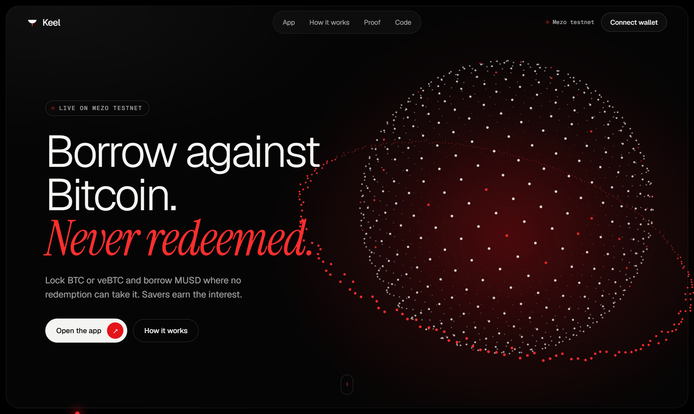
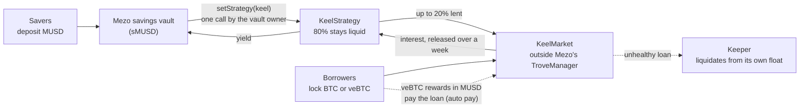
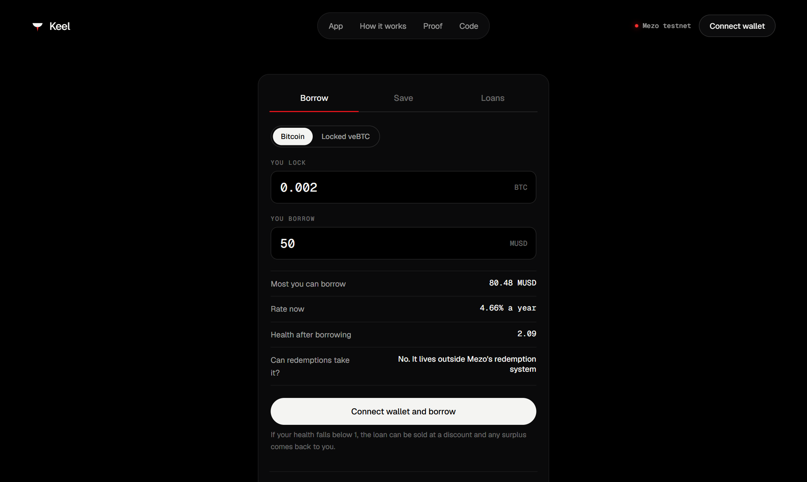

<p align="center">
  
</p>

<h1 align="center">Keel</h1>

<p align="center">
  <b>Borrow against your Bitcoin. Never redeemed.</b><br />
  A drop in strategy for Mezo's MUSD savings vault: it lends idle savings to BTC and veBTC holders, outside redemptions, and the interest goes to savers.
</p>

<p align="center">
  <a href="https://keel-psi-seven.vercel.app"></a>
  <a href="https://youtu.be/3Wd_9V7KwTg"></a>
  <a href="https://github.com/jenzylove/keel/actions/workflows/verify.yml"></a>
  <a href="https://keel-psi-seven.vercel.app/proof"></a>
  
  
  
  
  
  <a href="https://x.com/dollar782"></a>
</p>

<p align="center">
  
</p>

## The problem, read from Mezo mainnet

- **MUSD has traded under $0.9925 since July.** Redeeming 1 MUSD pays $1 of BTC minus 0.75%, so below that price anyone can buy MUSD cheap and redeem it against the weakest loan.
- **That emptied the loan book.** There were 49 MUSD loans in June and 1 on 2026-10-20.
- **Savers are paid by that same process.** The vault's idle savings, 1.30M MUSD on 2026-11-08, are lent to no one. In the 30 days to 2026-10-21 savers earned about 3% a year, and 65% of it arrived as BTC fees that redemptions pay. With almost no loans left, that income is running out.
- **Locked Bitcoin can't be borrowed against.** 806 BTC sits in veBTC, and Mezo's own FAQ says it can't be used as collateral.

## What Keel does

Keel is a drop in strategy for Mezo's MUSD Savings Vault. One call, `setStrategy`, by the multisig that already owns the vault moves the idle MUSD into it.

1. **At least 80% stays liquid** for withdrawals on Mezo's main vault. The small opt in mainnet vault, capped at 2,000 MUSD, keeps at least half liquid.
2. **Up to 20% is lent** (half on the opt in vault) against BTC or a veBTC NFT, in KeelMarket rather than Mezo's TroveManager, so redemptions can't reach those loans. veBTC borrowers keep voting and keep their rewards.
3. **Interest goes to savers** over a week, with 10% kept as a reserve that absorbs losses first.
4. **The rate leans against the peg.** Below $0.995 it steps up, at most 1 point a week, read from a 24 hour average of Mezo's own mUSDC/MUSD pool. New borrowing pauses when that pool's dollar side runs thin.
5. **Settings only change after a delay**, and only the vault's owner can propose them. Keel adds no new party to trust. On the opt in mainnet vault that owner is a 48 hour TimelockController, so no admin call lands in less than two days.
6. **Move a Mezo loan into Keel with one signature.** A borrower signs one message for Mezo's own loan contracts (BorrowerOperationsSignatures). In one transaction Keel pays the Mezo loan off with savers' MUSD, Mezo sends its BTC to Keel, and the same debt opens in Keel, outside redemptions. No MUSD needed up front. A real Mezo testnet loan moved this way on 2026-11-12 (tx `0x4e8da82a06c84f1ebb32dc99d2c63a8a88b3817ec6c5a311005898e7b6300fe0`), and the fork tests run it against Mezo mainnet's loan contracts.
7. **Rewards pay the loan.** A veBTC lock keeps voting through Keel. Every Thursday its pool pays voters; Keel collects the lock's share, swaps BTC rewards into MUSD on Mezo's own BTC/MUSD pool (priced against Mezo's PriceFeed, 2% at most off), and pays the loan, interest first. With auto pay on, the keeper does it for you; the first payment landed on 2026-11-12.
8. **Withdrawals degrade gracefully.** `withdrawable()` says exactly what can leave now, the reserve covers a leaving saver, and new borrowing pauses before liquid savings fall under a 10% buffer.
9. **A protocol share pays the keeper.** A timelocked share of interest, 5% on the mainnet vault and 0 on testnet, pays for the keeper and hosting. Savers get the rest.

## How it works



Redemptions only reach loans in Mezo's TroveManager. A Keel loan lives in KeelMarket, so no redemption can take it; the only way it closes early is a normal liquidation if BTC falls far enough, and any surplus goes back to the borrower.

## Start here

| | |
|---|---|
| **Demo video** | [youtu.be/3Wd_9V7KwTg](https://youtu.be/3Wd_9V7KwTg): what changed in Wave 2, with a real Mezo loan moved into Keel live on testnet. Wave 1 video: [youtu.be/iSvGuXuLK7A](https://youtu.be/iSvGuXuLK7A) |
| **Deck** | [docs/Keel-deck.pdf](docs/Keel-deck.pdf) |
| **Live site** | [keel-psi-seven.vercel.app](https://keel-psi-seven.vercel.app): the app on Mezo mainnet (opt in vault) and testnet, with Mezo mainnet readings |
| **Use it** | [/app](https://keel-psi-seven.vercel.app/app): Borrow, Save and Loans, quote before any wallet, Connect wallet top right |
| **Run a real loan, no wallet** | press "No wallet? Watch our demo wallet run a real loan" in the panel on [/app](https://keel-psi-seven.vercel.app/app), or open [/demo](https://keel-psi-seven.vercel.app/demo): a demo wallet locks BTC, borrows, repays and gets its BTC back, each step a real testnet transaction |
| **Proof** | [/proof](https://keel-psi-seven.vercel.app/proof) and [docs/proof/testnet-runs.md](docs/proof/testnet-runs.md): every result with its evidence: testnet transactions, mainnet copy tests and the eval |
| **Product spec** | [docs/PRD.md](docs/PRD.md), including the questions the Mezo team will ask |
| **Audit notes** | [docs/AUDIT.md](docs/AUDIT.md) |
| **Eval** | [docs/eval/RESULTS.md](docs/eval/RESULTS.md): the contracts against an answer key, peg term on and off |
| **Security** | [SECURITY.md](SECURITY.md): scope, protections and how to report |
| **Verified contracts** | KeelStrategy, KeelMarket, the peg oracle and the vault on Sourcify (links under Contracts) |
| **Video script** | [docs/video/script.md](docs/video/script.md) and [subtitles](docs/video/keel-demo.srt) |

## Judge fast path

No keys needed.

1. Open the [app](https://keel-psi-seven.vercel.app/app) and read the live quote in the Borrow tab.
2. Press "No wallet? Watch our demo wallet run a real loan" and open any transaction link.
3. Open [/proof](https://keel-psi-seven.vercel.app/proof): savers paid back with interest, a bad loan cleared by the keeper, and the plug in on a copy of Mezo mainnet.
4. On /proof, finding 04: a veBTC loan votes for a Mezo pool through Keel, on Mezo's own voter, with auto pay on.
5. Read the problem in Mezo's own numbers on the [landing page](https://keel-psi-seven.vercel.app/#problem).
6. Optional: run the mainnet fork test command shown in "Run it".

## What is real and what is not

| Part | Status |
|---|---|
| Contracts on Mezo mainnet and testnet | Live, real transactions |
| Mainnet integration | Proven on a copy of mainnet with Mezo's real savings vault |
| Opt in vault on Mezo mainnet | Live with real money on Mezo's own MUSD, PriceFeed and pool price. Keel's own wallet made the first deposit (10 MUSD) and loan (5 MUSD against BTC); the vault is owned by a 48 hour timelock |
| veBTC votes and auto pay | Real testnet transactions on Mezo's own voter, through Keel; the keeper claims rewards to the loan after each weekly epoch |
| Contracts | Keel's contracts, the mainnet timelock and idle strategy verified on Sourcify, exact match; the vault runs Mezo's own savings vault source, vendored unchanged |
| Home page numbers | Read live from Mezo testnet and mainnet |
| Demo wallet loan | Real testnet transactions |
| Loop run | Real testnet transactions, fresh wallets playing both sides |
| Keeper | Daily cron on testnet and mainnet, each with its own key and MUSD float; real testnet liquidation on 2026-10-22 |
| Savers' yield on Mezo mainnet today | Read live from the vault's yield index |

## The front door

<p align="center">
  
</p>

The app lives at /app, with Connect wallet in the top bar on every page. One panel, three tabs:

- **Borrow** shows a live quote before any wallet: the most you can borrow, the rate, your health after borrowing, and that redemptions can't take the loan. A wallet is asked for only when you press the action. Collateral is Bitcoin or a veBTC lock.
- **Save** takes MUSD, shows the live saver rate, and caps a withdrawal at what can leave right now.
- **Loans** lists your loans with Repay and close. A veBTC loan also gets Vote, Claim rewards to loan and an auto pay switch.

A wallet with no BTC gets a short guide: free test BTC from Mezo's faucet to try Keel, or real BTC from USDC or ETH through Mezo's own bridge.

A live wallet test on the deployed site on 2026-10-24 ran save, borrow, repay and close end to end with a test wallet, and each step was confirmed in the app.

**The loop run.** Fresh wallets play two savers and three borrowers on Mezo testnet. Savers deposited 120 MUSD. Borrowers took 75 MUSD across three loans, one of them against a veBTC lock (#407) the borrower created, repaid with interest about four hours later and got their collateral back. Each saver withdrew 60.0000015 MUSD for their 60; the rest of the interest keeps releasing over the week by design. All 36 steps are on /proof, under "Savers got their money back, with interest". Script: [contracts/script/loop.mjs](contracts/script/loop.mjs), record: [deployments/loop-run.json](deployments/loop-run.json).

**The keeper** is a daily Vercel cron that runs on testnet and on the mainnet vault, each with its own key and MUSD float. It claims savers' yield, steps the peg premium, liquidates unhealthy loans and claims veBTC rewards to loans with auto pay on. It liquidated an unhealthy loan on an earlier testnet market on 2026-10-22 (tx `0xc190a65dcf0e93a0b8572c1105e265c3d49885eecdab3561e9897cc2497e4a42`).


## Contracts

| Contract | What it does |
|---|---|
| [`KeelStrategy`](contracts/src/KeelStrategy.sol) | Implements Mezo's `IVaultStrategy`. Holds savers' principal, lends a capped share, keeps the reserve, releases yield |
| [`KeelMarket`](contracts/src/KeelMarket.sol) | Loans against BTC and veBTC, liquidation, vote and reward passthrough, peg premium, throttle, config timelock |
| [`KeelMath`](contracts/src/libraries/KeelMath.sol) | Interest, health, liquidation and the rate curve |
| [`PegOracles`](contracts/src/oracles/PegOracles.sol) | MUSD price from Mezo pools: concentrated liquidity TWAP on mainnet, basic pool `quote()` on testnet |

Mainnet: [vault](https://explorer.mezo.org/address/0x9450b4a37fd7f247194f0eb0e18d0fe3a671483d), [KeelStrategy](https://repo.sourcify.dev/31612/0x0298c746fc52f1b9bb1449de0464bf4056806509), [KeelMarket](https://repo.sourcify.dev/31612/0x3d6e71dfc30fdf24b8d2a9f9d564c3dc7c29d0d9), [peg oracle](https://repo.sourcify.dev/31612/0x557cfccd083f26150189ecb07cc945bcf3698eb5), all verified on Sourcify; addresses and the first run in [deployments/mainnet.json](deployments/mainnet.json) and [deployments/mainnet-run.json](deployments/mainnet-run.json).

Testnet addresses are in [deployments/testnet.json](deployments/testnet.json). Verified on Sourcify: [KeelStrategy](https://repo.sourcify.dev/31611/0xdab084ebfd118489ada2021c5e60afd5e2fc26f9) · [KeelMarket](https://repo.sourcify.dev/31611/0x32a94a9af2751afc771aa09d00d95faa6629135e) · [peg oracle](https://repo.sourcify.dev/31611/0x8e64a1f8c51b10648eb744925a1ed91b2aeb25f7) · [vault](https://repo.sourcify.dev/31611/0x40d5b453eb25dd8b1dfd484c0b80f7ede0dc7def). Reverify any deployment with `node script/verify.mjs testnet`.

## Run it

```bash
# contracts: unit, fuzz and eval tests
cd contracts && npm ci && forge test --no-match-path 'test/fork/*'

# mainnet copy: Mezo's multisig moves the vault's real idle savings into Keel
forge test --match-path 'test/fork/*'

# the loop: fresh wallets play savers and borrowers on testnet (run from contracts/)
node script/loop.mjs open
# the loop: repay, close and withdraw, the second half
node script/loop.mjs close

# deploy to Mezo testnet (mainnet dry run on a fork passes)
node script/deploy.mjs testnet

# eval: recompute every number from the PRD's rules and compare
cd .. && python3 eval/answer_key.py

# app
cd app && npm ci && npm run dev
```

## Scope

- Keel runs on Mezo testnet and in a small opt in vault on Mezo mainnet, capped at 2,000 MUSD. Moving Mezo's own savings vault onto Keel is one governance call, run on a copy of mainnet in the fork tests.
- The contracts are unaudited. Savers carry bad debt beyond the reserve, which is why lending is capped.
- Borrower demand on Mezo is small today: about 60 BTC outside veBTC and the Enclaves, plus a handful of mid sized veBTC locks.

## License

MIT
