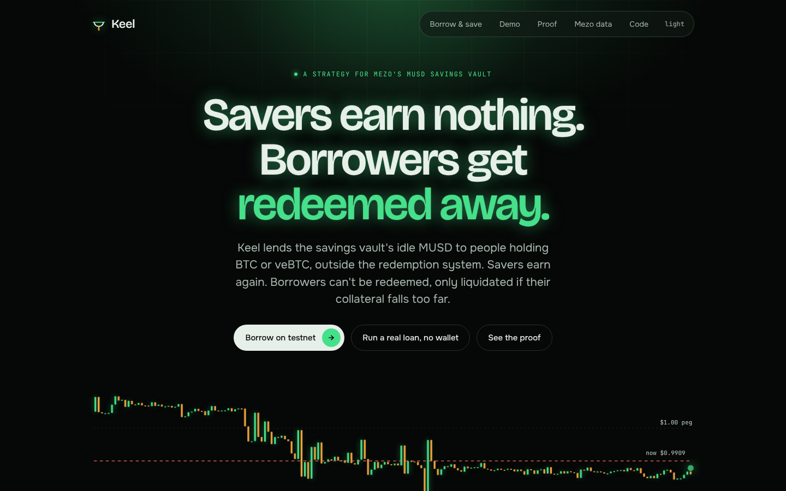

<p align="center">
  
</p>

<h1 align="center">Keel</h1>

<p align="center">
  <b>Mezo's savings vault lends its idle MUSD to Bitcoin holders, outside redemptions.</b><br />
  Savers earn from borrowers who stay. Borrowers can't be redeemed away.
</p>

<p align="center">
  <a href="https://keel-psi-seven.vercel.app"></a>
  
  
  
  
</p>

<p align="center">
  
</p>

## The problem, read from Mezo mainnet

- **MUSD has traded under $0.9925 since July.** Redeeming 1 MUSD pays $1 of BTC minus 0.75%, so below that price anyone can buy MUSD cheap and redeem it against the weakest loan.
- **That emptied the loan book.** There were 49 MUSD loans in June and 1 on 2026-10-20.
- **Savers are paid by that same process.** The vault's 7.38M MUSD of principal is lent to no one. Savers earned about 3% a year over the last 30 days, and 65% of it arrived as BTC fees that redemptions pay. With almost no loans left, that income is running out.
- **Locked Bitcoin can't be borrowed against.** 806 BTC sits in veBTC, and Mezo's own FAQ says it can't be used as collateral.

## What Keel does

Keel is a drop in strategy for Mezo's MUSD Savings Vault. One call, `setStrategy`, by the multisig that already owns the vault moves the idle MUSD into it.

1. **At least 80% stays liquid** for withdrawals.
2. **Up to 20% is lent** against BTC or a veBTC NFT, in KeelMarket rather than Mezo's TroveManager, so redemptions can't reach those loans. veBTC borrowers keep voting and keep their rewards.
3. **Interest goes to savers** over a week, with 10% kept as a reserve that absorbs losses first.
4. **The rate leans against the peg.** Below $0.995 it steps up, at most 1 point a week, read from a 24 hour average of Mezo's own mUSDC/MUSD pool. New borrowing pauses when that pool's dollar side runs thin.
5. **Settings only change after a delay**, and only the vault's owner can propose them. Keel adds no new party to trust.

## Start here

| | |
|---|---|
| **Live site** | [keel-psi-seven.vercel.app](https://keel-psi-seven.vercel.app): live mainnet readings, then Keel running on testnet |
| **Run a real loan, no wallet** | [/demo](https://keel-psi-seven.vercel.app/demo): a server wallet locks BTC, borrows, repays and gets its BTC back, each step a real transaction |
| **Borrow or save yourself** | [/use](https://keel-psi-seven.vercel.app/use) on Mezo testnet |
| **Proof** | [/proof](https://keel-psi-seven.vercel.app/proof) and [docs/proof/testnet-runs.md](docs/proof/testnet-runs.md): every claim linked to a transaction |
| **Mezo's numbers** | [/data](https://keel-psi-seven.vercel.app/data): the loop, read live from mainnet and archive state |
| **Product spec** | [docs/PRD.md](docs/PRD.md), including the questions the Mezo team will ask |
| **Audit notes** | [docs/AUDIT.md](docs/AUDIT.md) |
| **Eval** | [docs/eval/RESULTS.md](docs/eval/RESULTS.md): the contracts against an answer key, peg term on and off |

## Contracts

| Contract | What it does |
|---|---|
| [`KeelStrategy`](contracts/src/KeelStrategy.sol) | Implements Mezo's `IVaultStrategy`. Holds savers' principal, lends a capped share, keeps the reserve, releases yield |
| [`KeelMarket`](contracts/src/KeelMarket.sol) | Loans against BTC and veBTC, liquidation, vote and reward passthrough, peg premium, throttle, config timelock |
| [`KeelMath`](contracts/src/libraries/KeelMath.sol) | Interest, health, liquidation and the rate curve |
| [`PegOracles`](contracts/src/oracles/PegOracles.sol) | MUSD price from Mezo pools: concentrated liquidity TWAP on mainnet, basic pool `quote()` on testnet |

Testnet addresses are in [deployments/testnet.json](deployments/testnet.json).

## Run it

```bash
# contracts: unit, fuzz and eval tests
cd contracts && npm ci && forge test --no-match-path 'test/fork/*'

# mainnet fork: Mezo's multisig moves the real 7.38M into Keel
forge test --match-path 'test/fork/*'

# eval: recompute every number from the PRD's rules and compare
cd .. && python3 eval/answer_key.py

# app
cd app && npm ci && npm run dev
```

## Scope

- The live product runs on Mezo testnet. Mainnet readings are read only, and the mainnet integration is proven on a fork.
- The contracts are unaudited. Savers carry bad debt beyond the reserve, which is why lending is capped at 20%.
- Borrower demand on Mezo is small today: about 60 BTC outside veBTC and the Enclaves, plus a handful of mid sized veBTC locks.

## License

MIT
