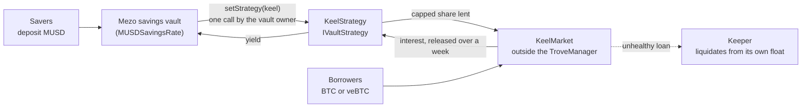
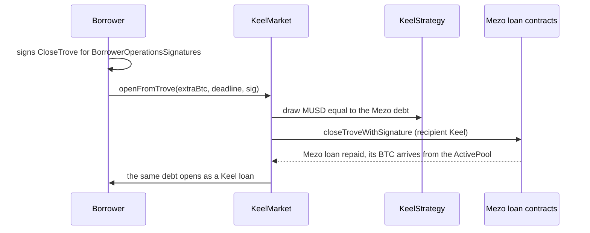
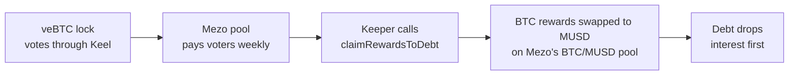

<p align="center">
  
</p>

<h1 align="center">Keel</h1>

<p align="center">
  <b>Borrow against your Bitcoin. Never redeemed.</b><br />
  A strategy for Mezo's MUSD savings vault that lends idle savings to BTC and veBTC holders, outside the redemption system, and pays the interest to savers.
</p>

<p align="center">
  <a href="https://keel-psi-seven.vercel.app"></a>
  <a href="https://youtu.be/3Wd_9V7KwTg"></a>
  <a href="docs/Keel-deck.pdf"></a>
  <a href="https://keel-psi-seven.vercel.app/proof"></a>
  <a href="https://github.com/jenzylove/keel/actions/workflows/verify.yml"></a>
  
  
  
  
  
  <a href="https://x.com/dollar782"></a>
</p>

<p align="center">
  
</p>

## New in Wave 2

| What | Proof |
|---|---|
| **Move a Mezo loan into Keel with one signature.** Keel pays the Mezo loan off with savers' MUSD, Mezo sends the BTC to Keel, and the same debt opens in Keel. No MUSD needed up front. | Testnet [tx 0x4e8d…0fe0](https://explorer.test.mezo.org/tx/0x4e8da82a06c84f1ebb32dc99d2c63a8a88b3817ec6c5a311005898e7b6300fe0) moved a 0.036 BTC, 1,803 MUSD Mezo loan. Fork tests run it on Mezo mainnet's own loan contracts: [MoveTrove.t.sol](contracts/test/fork/MoveTrove.t.sol) |
| **veBTC auto pay.** A lock keeps voting through Keel; the keeper claims its weekly rewards, swaps BTC rewards to MUSD on Mezo's BTC/MUSD pool, and pays the loan. | First payment [tx 0x27ae…96cd](https://explorer.test.mezo.org/tx/0x27ae334af6adaeb50ea02fb68b7994366ce586cb73f4a81af5e02b8fb92b96cd): 0.0027 MUSD of rewards paid loan #4 on the previous testnet market. The swap runs against the real mainnet pool in `test_mainnet_btc_reward_swaps_on_the_real_pool`. veBTC #424 [votes](https://explorer.test.mezo.org/tx/0x6f98e970acf9e51dfe7bc813fab140233b97c853ccd5a84091674fd791e1d0bc) on the current market with auto pay [on](https://explorer.test.mezo.org/tx/0x50470ae004d65b263a4ea1889e42486ad3143c388870be28a5d19baa3dcdbcea) ([wave2-run.json](deployments/wave2-run.json)) |
| **Live opt in vault on Mezo mainnet**, owned by a 48 hour TimelockController, with a daily keeper. | [Timelock](https://explorer.mezo.org/tx/0x91cac23934608b726bf8420e2bcf60d457619ab062c1c55e572752a7dfe93f1d), [ownership handed over](https://explorer.mezo.org/tx/0x39ee37c6165e6eb5f11a47c5c72da22a6c612afe1eaca475a133b8829960fd39), [first keeper run](https://explorer.mezo.org/tx/0xbceb1ea19472b909aa81c28b074fd0fd0cd0696d8c2a8fa5564626ec2ebc05d4) |
| **Graceful withdrawals.** `withdrawable()` says exactly what can leave now; new borrowing pauses before liquid savings fall under a 10% buffer. | [KeelStrategy.sol](contracts/src/KeelStrategy.sol), [GracefulWithdraw.t.sol](contracts/test/GracefulWithdraw.t.sol) (fuzzed) |
| **5% protocol share** of interest on mainnet pays the keeper and hosting, changeable only through the timelock. | `feeBps` = 500 on [KeelStrategy](https://explorer.mezo.org/address/0x0298c746fc52f1b9bb1449de0464bf4056806509?tab=contract) |
| **Testnet / Mainnet switch and BTC onboarding.** One app for both networks; a wallet with no BTC gets Mezo's faucet (testnet) or Mezo's bridge (mainnet). | [KeelApp.tsx](app/components/KeelApp.tsx), [GetBtc.tsx](app/components/GetBtc.tsx) |
| **Every contract verified on Mezo's explorer**, mainnet and testnet. | Links under [Live deployments](#live-deployments) |

## Review in two minutes

1. Open the [app](https://keel-psi-seven.vercel.app/app). The Borrow tab shows a live quote before any wallet: the most you can borrow, the rate, your health, and that redemptions can't reach the loan.
2. No wallet? Press "No wallet? Watch our demo wallet run a real loan on Mezo testnet" or open [/demo](https://keel-psi-seven.vercel.app/demo). A demo wallet locks BTC, borrows, repays and gets its BTC back, each step a real testnet transaction.
3. Open [/proof](https://keel-psi-seven.vercel.app/proof): the mainnet run, the loan move, auto pay, the loop with fresh wallets, liquidation and the eval, every row linked to Mezo's explorer.
4. One link to open: the [loan move](https://explorer.test.mezo.org/tx/0x4e8da82a06c84f1ebb32dc99d2c63a8a88b3817ec6c5a311005898e7b6300fe0). One transaction closes a Mezo loan and opens it in Keel.
5. Run the tests: `cd contracts && npm ci && forge test --no-match-path 'test/fork/*'` (108 pass).

Demo video: [youtu.be/3Wd_9V7KwTg](https://youtu.be/3Wd_9V7KwTg) ([script](docs/video/script-wave2.md), [subtitles](docs/video/keel-wave2.srt)). Wave 1 video: [youtu.be/iSvGuXuLK7A](https://youtu.be/iSvGuXuLK7A). Deck: [docs/Keel-deck.pdf](docs/Keel-deck.pdf).

## Live deployments

**Mezo mainnet** (chain 31612). Addresses in [deployments/mainnet.json](deployments/mainnet.json).

| Contract | Address |
|---|---|
| Vault (Mezo's MUSDSavingsRate source, unchanged, behind a proxy) | [0x9450…483d](https://explorer.mezo.org/address/0x9450b4a37fd7f247194f0eb0e18d0fe3a671483d?tab=contract) |
| KeelStrategy | [0x0298…6509](https://explorer.mezo.org/address/0x0298c746fc52f1b9bb1449de0464bf4056806509?tab=contract) |
| KeelMarket | [0x3d6e…d0d9](https://explorer.mezo.org/address/0x3d6e71dfc30fdf24b8d2a9f9d564c3dc7c29d0d9?tab=contract) |
| Peg oracle (24 hour TWAP of Mezo's mUSDC/MUSD pool) | [0x557c…8eb5](https://explorer.mezo.org/address/0x557cfccd083f26150189ecb07cc945bcf3698eb5?tab=contract) |
| TimelockController (owns the vault, 48 hour delay) | [0x2f13…778a](https://explorer.mezo.org/address/0x2f131C3e4aE7BcBB291859559c9bC720533a778a?tab=contract) |

The mainnet vault is capped at 2,000 MUSD of savings and may lend up to half. Its market predates the loan move and the reward swap; both run on testnet today and against mainnet's own contracts in the fork tests.

**Mezo testnet** (chain 31611). Addresses in [deployments/testnet.json](deployments/testnet.json).

| Contract | Address |
|---|---|
| Vault | [0x40d5…7def](https://explorer.test.mezo.org/address/0x40d5b453eb25dd8b1dfd484c0b80f7ede0dc7def?tab=contract) |
| KeelStrategy | [0xdab0…26f9](https://explorer.test.mezo.org/address/0xdab084ebfd118489ada2021c5e60afd5e2fc26f9?tab=contract) |
| KeelMarket | [0xc325…9bf3](https://explorer.test.mezo.org/address/0xc325f2d30a8ee121906391160ab1cbaeb75d9bf3?tab=contract) |
| Peg oracle | [0x8e64…25f7](https://explorer.test.mezo.org/address/0x8e64a1f8c51b10648eb744925a1ed91b2aeb25f7?tab=contract) |

The testnet market was upgraded on November 12, 2026 to add the loan move and the reward swap, wired to the same vault and strategy so savers stayed put. The previous market is [0x32a9…135e](https://explorer.test.mezo.org/address/0x32a94a9af2751afc771aa09d00d95faa6629135e?tab=contract).

## The problem, read from Mezo mainnet

- **Redemption sells the borrower's BTC out from under them.** Anyone can hand Mezo 1 MUSD and take $1 of BTC from the weakest loan, less a 0.75% fee (`redemptionRate()` on [BorrowerOperations](https://explorer.mezo.org/address/0x44b1bac67dDA612a41a58AAf779143B181dEe031?tab=contract)). Below $0.9925 that is free money for the redeemer.
- **MUSD has traded mostly under $0.9925 since July:** 100 of 114 daily closes from July 1 to October 21 ([CoinGecko data](eval/data/musd-daily-coingecko.json)).
- **That emptied the loan book.** `getTroveOwnersCount()` on Mezo's [TroveManager](https://explorer.mezo.org/address/0x94AfB503dBca74aC3E4929BACEeDfCe19B93c193?tab=contract): 50 open loans on June 23, 1 on October 20, 4 on November 12.
- **Savings sit idle.** 1.32M MUSD rests in the savings vault's [IdleStrategy](https://explorer.mezo.org/address/0x0C0944713c185ea3e64F5609ECee3fB3C054a295) today, lent to no one.
- **Locked Bitcoin can't be borrowed against.** 789 BTC sits in [veBTC](https://explorer.mezo.org/address/0x3D4b1b884A7a1E59fE8589a3296EC8f8cBB6f279) today, and Mezo doesn't accept it as loan collateral.

Keel loans live in KeelMarket, not in Mezo's TroveManager, so no redemption can reach them. The only way a Keel loan closes early is a normal liquidation if BTC falls far enough, and any surplus goes back to the borrower.

## How it works



1. Savers deposit MUSD in the vault. One `setStrategy` call by the vault's owner points it at KeelStrategy.
2. KeelStrategy keeps most savings liquid and lends a capped share (20% in the main vault design, half on the small mainnet vault).
3. Borrowers lock BTC or a veBTC NFT in KeelMarket. BTC is priced by Mezo's PriceFeed.
4. Interest reaches savers over a week; 10% builds a reserve that takes losses first.
5. The rate leans against the peg: below $0.995 on a 24 hour TWAP of Mezo's mUSDC/MUSD pool, it steps up by at most 1 point a week. New borrowing pauses when that pool's dollar side runs thin.

**Moving a Mezo loan into Keel**



**veBTC auto pay**



The swap must fill within 2% of Mezo's PriceFeed value or the BTC goes to the borrower instead.

## Built on Mezo

Every Mezo contract Keel calls at runtime. Mainnet addresses; testnet ones are in [deploy.mjs](contracts/script/deploy.mjs) and [networks.ts](app/lib/networks.ts).

| Mezo contract | What Keel uses it for | Where |
|---|---|---|
| [MUSD](https://explorer.mezo.org/address/0xdD468A1DDc392dcdbEf6db6e34E89AA338F9F186) | The asset savers deposit and borrowers take | [KeelMarket.sol](contracts/src/KeelMarket.sol) `_borrow`, `repay`; [KeelStrategy.sol](contracts/src/KeelStrategy.sol) `draw`, `repaid` |
| [MUSDSavingsRate](https://explorer.mezo.org/address/0xb4D498029af77680cD1eF828b967f010d06C51CC) and its `IVaultStrategy` | KeelStrategy is a strategy for it; Keel's vaults run its source unchanged | [IVaultStrategy.sol](contracts/src/interfaces/IVaultStrategy.sol); KeelStrategy `allocate`, `deallocate`, `claimYield`, `migrate`; [vendor/musd-savings-rate](contracts/vendor/musd-savings-rate/contracts/vaults/MUSDSavingsRate.sol) |
| [PriceFeed](https://explorer.mezo.org/address/0xc5aC5A8892230E0A3e1c473881A2de7353fFcA88) | BTC price for borrow limits, liquidation and the swap floor | KeelMarket `_btcPrice` (`fetchPrice`) |
| [BorrowerOperationsSignatures](https://explorer.mezo.org/address/0xB57ab578BF20b3e318f3EFAA587C51DBccE5df7a) | Closes the borrower's Mezo loan with their signature, BTC sent to Keel | KeelMarket `_closeTrove` (`closeTroveWithSignature`); app reads `getNonce` in [KeelApp.tsx](app/components/KeelApp.tsx) |
| [TroveManager](https://explorer.mezo.org/address/0x94AfB503dBca74aC3E4929BACEeDfCe19B93c193) | Reads the Mezo loan's BTC and debt; loan count for the landing page | KeelMarket `openFromTrove` (`updateSystemAndTroveInterest`, `getTroveColl`, `getTroveDebt`); [reads.ts](app/lib/reads.ts) `getTroveOwnersCount` |
| [BorrowerOperations](https://explorer.mezo.org/address/0x44b1bac67dDA612a41a58AAf779143B181dEe031) | Gas compensation, so the moved debt matches what Mezo burns | KeelMarket `openFromTrove` (`MUSD_GAS_COMPENSATION`) |
| [ActivePool](https://explorer.mezo.org/address/0x3012C2fE1240e3754E5C200A0946bb0E07474876) | The only sender KeelMarket accepts BTC from, and only during a move | KeelMarket `receive` |
| [veBTC VotingEscrow](https://explorer.mezo.org/address/0x3D4b1b884A7a1E59fE8589a3296EC8f8cBB6f279) | Locks as collateral: type, size, custody, extension | KeelMarket `openWithVeBTC`, `extendLock`, `close`, `_valueAndRisk` |
| [Voter](https://explorer.mezo.org/address/0x48233cCC97B87Ba93bCA212cbEe48e3210211f03) | Votes and claims for a lock held by Keel | KeelMarket `vote`, `resetVotes`, `_claim` (`claimFees`, `claimBribes`) |
| Fee and bribe reward contracts, per pool (e.g. BTC/MUSD [fees](https://explorer.mezo.org/address/0x0453820c89084E20658068A27EbB90824F1A6C6d), [bribes](https://explorer.mezo.org/address/0x94A9A494872BF7231D8378d0Aef7d32BA552E305)) | Where a lock's weekly rewards come from | `claimRewardsToDebt`; list read from the voter in [pools.ts](app/lib/pools.ts); keeper in [route.ts](app/app/api/keeper/route.ts) |
| [BTC/MUSD pool](https://explorer.mezo.org/address/0x52e604c44417233b6CcEDDDc0d640A405Caacefb) | Swaps BTC rewards into MUSD | KeelMarket `swapForMusd` (`getAmountOut`, `swap`) |
| [mUSDC/MUSD pool](https://explorer.mezo.org/address/0xCC372B7E15535aB225fe17c1075831D38ef7aC1a) | 24 hour TWAP for the peg premium; its mUSDC balance gates new borrowing | [PegOracles.sol](contracts/src/oracles/PegOracles.sol) `musdPrice` (`observe`); KeelMarket `borrowingOpen` |
| [InterestRateManager](https://explorer.mezo.org/address/0x4a453700d157717Fe02fB62E7700ED7845048285) | Mezo's loan rate (1% today), shown beside Keel's on the move card | [KeelApp.tsx](app/components/KeelApp.tsx) (`interestRate`) |
| [BTC](https://explorer.mezo.org/address/0x7b7C000000000000000000000000000000000000) | Collateral | KeelMarket `openWithBtc`, `addBtc`, `removeBtc` |

## Business model

**Who pays whom.** Borrowers pay interest. Of every payment, 10% builds the reserve that absorbs losses first, a protocol share (5% on mainnet, 0 on testnet) pays the keeper and hosting, and savers get the rest ([KeelStrategy `repaid`](contracts/src/KeelStrategy.sol)). The share can only change through `proposeParams` and `applyParams`, after the 48 hour delay.

**Honest pricing.** The move card shows Mezo's own rate (1% today, read live from InterestRateManager) beside Keel's. Keel's rate is utilisation based and read live: it rises as more savings are lent and falls as savers add MUSD. What the borrower buys with the difference is a loan no redemption can take.

**The size of the prize.**
- Savers: 1.32M MUSD sits idle in Mezo's savings vault today. One governance call, `setStrategy`, puts it to work; the fork test [SmusdMigration.t.sol](contracts/test/fork/SmusdMigration.t.sol) runs that call as Mezo's own multisig on a copy of mainnet.
- Borrowers: the move is built for every Mezo loan facing redemption, one signature each, and the 789 BTC in veBTC gets a way to borrow.

**For the main vault:** an external audit, then a governance `setStrategy` by Mezo's vault owner. Everything else is built and running.

## What ran for real

| Run | Network | Transaction |
|---|---|---|
| First deposit: 10 MUSD into the opt in vault | Mainnet | [0x4deb…dafd](https://explorer.mezo.org/tx/0x4deb4c52088ef0a58dd7a5260dff100bc97f86af41b2b30dd2128dc8d035dafd) |
| First loan: 0.00016 BTC locked, 5 MUSD borrowed | Mainnet | [0x68aa…b298](https://explorer.mezo.org/tx/0x68aad50cba1876600d4d7fc87a07dc6d8ff058b247f72e117c56eed57a53b298) |
| 48 hour TimelockController takes ownership of the vault | Mainnet | [0x39ee…fd39](https://explorer.mezo.org/tx/0x39ee37c6165e6eb5f11a47c5c72da22a6c612afe1eaca475a133b8829960fd39) |
| Keeper's first daily run | Mainnet | [0xbceb…05d4](https://explorer.mezo.org/tx/0xbceb1ea19472b909aa81c28b074fd0fd0cd0696d8c2a8fa5564626ec2ebc05d4) |
| A Mezo loan moved into Keel in one transaction | Testnet | [0x4e8d…0fe0](https://explorer.test.mezo.org/tx/0x4e8da82a06c84f1ebb32dc99d2c63a8a88b3817ec6c5a311005898e7b6300fe0) |
| Auto pay: rewards pay a loan, nobody touching it | Testnet | [0x27ae…96cd](https://explorer.test.mezo.org/tx/0x27ae334af6adaeb50ea02fb68b7994366ce586cb73f4a81af5e02b8fb92b96cd) |
| veBTC #424 votes through Keel on the current market | Testnet | [0x6f98…d1bc](https://explorer.test.mezo.org/tx/0x6f98e970acf9e51dfe7bc813fab140233b97c853ccd5a84091674fd791e1d0bc) |
| Keeper liquidates an unhealthy loan from its own float | Testnet | [0xc190…4a42](https://explorer.test.mezo.org/tx/0xc190a65dcf0e93a0b8572c1105e265c3d49885eecdab3561e9897cc2497e4a42) |
| The loop: two savers, three borrowers, 36 steps, savers withdraw 60.0000015 MUSD for 60 | Testnet | [loop-run.json](deployments/loop-run.json), last step [0xda22…b411](https://explorer.test.mezo.org/tx/0xda22fa9faaf63330356764189d17f9d7bdb875bcf90120b94d7418f45dd6b411) |

Every run, with every step, is on [/proof](https://keel-psi-seven.vercel.app/proof). Records: [mainnet-run.json](deployments/mainnet-run.json), [move-run.json](deployments/move-run.json), [wave2-run.json](deployments/wave2-run.json), [testnet-runs.md](docs/proof/testnet-runs.md).

<p align="center">
  
</p>

## Contracts and tests

| Contract | What it does | Key functions |
|---|---|---|
| [KeelStrategy](contracts/src/KeelStrategy.sol) | Mezo `IVaultStrategy`. Holds savers' principal, caps lending, keeps the reserve, releases yield over a week, pays the protocol share. Governed by the vault's owner, read live. | `allocate`, `deallocate`, `claimYield`, `migrate`, `withdrawable`, `proposeParams` / `applyParams` |
| [KeelMarket](contracts/src/KeelMarket.sol) | Loans against BTC or veBTC outside redemptions; loan moves from Mezo; voting and reward passthrough; auto pay with the BTC swap; liquidation; peg premium and throttle; config behind a delay. | `openWithBtc`, `openWithVeBTC`, `openFromTrove`, `vote`, `setAutoPay`, `claimRewardsToDebt`, `liquidate`, `stepPeg`, `proposeConfig` / `applyConfig` |
| [KeelMath](contracts/src/libraries/KeelMath.sol) | Interest, health, liquidation amounts and the rate curve | |
| [PegOracles](contracts/src/oracles/PegOracles.sol) | MUSD price from Mezo pools: TWAP of the concentrated liquidity pool on mainnet, basic pool `quote()` on testnet | `musdPrice` |
| [Timelock](contracts/src/governance/Timelock.sol) | OpenZeppelin TimelockController that owns the mainnet vault | |

**Unit, fuzz and eval tests: 108**, run with `forge test --no-match-path 'test/fork/*'`.

| Suite | Tests |
|---|---|
| [KeelMarket.t.sol](contracts/test/KeelMarket.t.sol) | 33 |
| [KeelStrategy.t.sol](contracts/test/KeelStrategy.t.sol) | 29 |
| [MoveTroveUnit.t.sol](contracts/test/MoveTroveUnit.t.sol) | 12 |
| [RewardSwap.t.sol](contracts/test/RewardSwap.t.sol) | 11 |
| [KeelMath.t.sol](contracts/test/KeelMath.t.sol) | 10 |
| [AuditRegression.t.sol](contracts/test/AuditRegression.t.sol) | 5 |
| [KeelEval.t.sol](contracts/test/eval/KeelEval.t.sol) | 5 |
| [GracefulWithdraw.t.sol](contracts/test/GracefulWithdraw.t.sol) | 3 |

**Fork tests on Mezo mainnet and testnet state: 11.**

| Suite | Tests | What it proves |
|---|---|---|
| [MoveTrove.t.sol](contracts/test/fork/MoveTrove.t.sol) | 5 | A real Mezo loan moves into Keel on mainnet and testnet; a front run signature reverts; the BTC reward swap fills on the real mainnet pool |
| [SmusdMigration.t.sol](contracts/test/fork/SmusdMigration.t.sol) | 3 | Mezo's multisig moves the real idle savings into Keel with one call; interest reaches savers; withdrawals stay open at full lending |
| [PegOracle.t.sol](contracts/test/fork/PegOracle.t.sol) | 2 | The oracle reads MUSD's price from mainnet pools |
| [VeBTCDecode.t.sol](contracts/test/fork/VeBTCDecode.t.sol) | 1 | Keel reads mainnet veBTC locks |

**Eval: 235 numbers.** [docs/eval/RESULTS.md](docs/eval/RESULTS.md) runs five scenarios through the real contracts, including 26 weeks of MUSD's real price, and checks every number against an answer key computed separately in [eval/answer_key.py](eval/answer_key.py). The first run caught a real accounting bug; it is fixed and all 235 match to the wei.

## Run it

```bash
# contracts: unit, fuzz and eval tests (Foundry, Node 20)
cd contracts && npm ci && forge test --no-match-path 'test/fork/*'

# fork tests on Mezo mainnet and testnet state (slower, uses public RPCs)
forge test --match-path 'test/fork/*'

# the loop: fresh wallets play savers and borrowers on testnet (needs contracts/.env)
node script/loop.mjs open
node script/loop.mjs close

# deploy to Mezo testnet (needs DEPLOYER_PK in contracts/.env)
node script/deploy.mjs testnet

# eval: recompute every number from Keel's rules and compare (from the repo root)
cd .. && python3 eval/answer_key.py

# app
cd app && npm ci && npm run dev
```

## Repository layout

```
app/            Next.js site and app: /app, /proof, /demo, daily keeper at app/api/keeper
contracts/
  src/          KeelStrategy, KeelMarket, KeelMath, PegOracles, Timelock
  test/         unit, fuzz and eval suites; test/fork for Mezo mainnet and testnet
  script/       deploy, loop, verify and upgrade scripts
  vendor/       Mezo's MUSDSavingsRate source, unchanged
deployments/    addresses and every recorded run, mainnet and testnet
docs/           deck, eval results, proof notes, video script, media
eval/           answer key and MUSD price data
scripts/data/   readers for the Mezo mainnet numbers above
```

## Security

Settings change only after a delay, and only the savings vault's owner can propose them; on mainnet that owner is a 48 hour TimelockController. Lending is capped, a reserve takes losses first, and repaying always stays open. See [SECURITY.md](SECURITY.md) for scope, protections and how to report a problem privately.

## License

[MIT](LICENSE)
